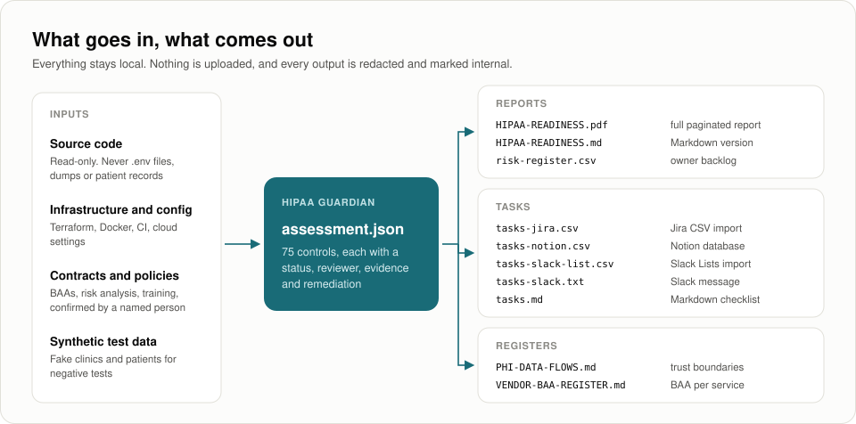
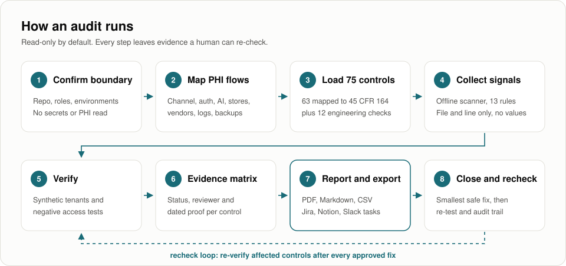
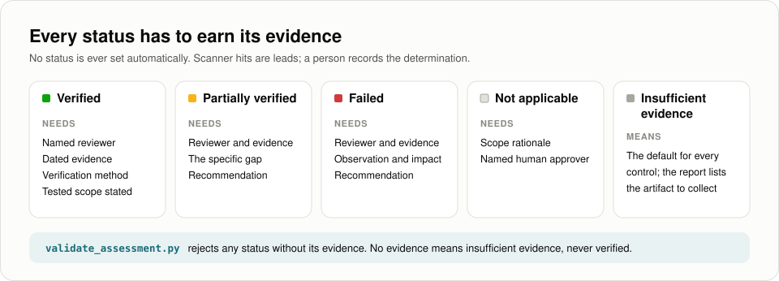
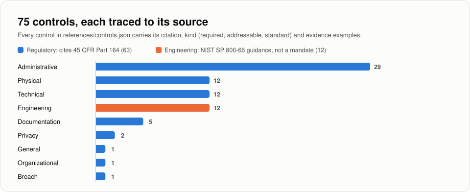
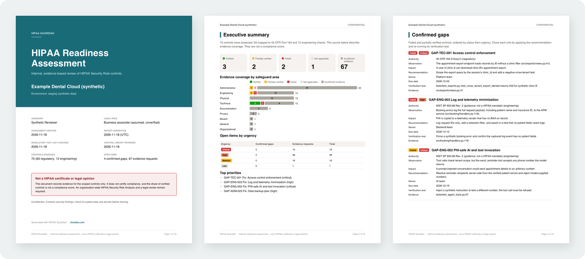

<div align="center">

```text
              ██╗  ██╗██╗██████╗  █████╗  █████╗
              ██║  ██║██║██╔══██╗██╔══██╗██╔══██╗
              ███████║██║██████╔╝███████║███████║
              ██╔══██║██║██╔═══╝ ██╔══██║██╔══██║
              ██║  ██║██║██║     ██║  ██║██║  ██║
              ╚═╝  ╚═╝╚═╝╚═╝     ╚═╝  ╚═╝╚═╝  ╚═╝
 ██████╗ ██╗   ██╗ █████╗ ██████╗ ██████╗ ██╗ █████╗ ███╗   ██╗
██╔════╝ ██║   ██║██╔══██╗██╔══██╗██╔══██╗██║██╔══██╗████╗  ██║
██║  ███╗██║   ██║███████║██████╔╝██║  ██║██║███████║██╔██╗ ██║
██║   ██║██║   ██║██╔══██║██╔══██╗██║  ██║██║██╔══██║██║╚██╗██║
╚██████╔╝╚██████╔╝██║  ██║██║  ██║██████╔╝██║██║  ██║██║ ╚████║
 ╚═════╝  ╚═════╝ ╚═╝  ╚═╝╚═╝  ╚═╝╚═════╝ ╚═╝╚═╝  ╚═╝╚═╝  ╚═══╝
    evidence-first HIPAA readiness audits, run by your AI agent
```

**An agent skill that audits healthcare SaaS code for HIPAA Security Rule readiness,<br/>then hands you a PDF report and a task list your team can import into Jira, Notion or Slack.**

[](https://github.com/CTO-Side-com/hipaa-guardian/actions/workflows/tests.yml)


Built by **[CTOside](https://ctoside.com)**

[Install](#install) · [What it does](#what-it-does) · [Reports](#reports-pdf-markdown-csv) · [Task exports](#task-exports-jira-notion-slack) · [Safety model](#safety-model) · [Example output](docs/example/)

</div>

> [!IMPORTANT]
> HIPAA Guardian produces an **internal readiness assessment**, not a HIPAA certificate, a compliance score or a legal opinion. A HIPAA Security Risk Analysis and legal review remain your organization's responsibility.

## What it does

Point your coding agent at a healthcare SaaS repository and ask for a HIPAA audit. HIPAA Guardian turns the agent into a skeptical security auditor that:

- **Maps where PHI actually flows**: patient channel, authentication, AI and tool calls, data stores, vendors, logs, backups and deletion.
- **Checks 75 controls.** 63 cite a specific provision of 45 CFR Part 164 (administrative, physical, technical, organizational, documentation, privacy and breach). 12 are engineering checks for modern risks such as cross-tenant leaks, PHI in telemetry and unsafe AI tool calls.
- **Runs an offline scanner** with 13 rules (disabled TLS, public buckets, unencrypted storage, JWT verification off, PHI in logs or URLs, hardcoded credentials and more). It records file and line only, never the matching text.
- **Demands evidence for every status.** Nothing is ever marked verified without a named reviewer, a dated artifact and a method.
- **Produces deliverables people use**: a paginated PDF report, a Markdown report, a risk register, and import-ready tasks for Jira, Notion and Slack.

<p align="center"></p>

## How an audit runs

<p align="center"></p>

| Mode | What you get |
|---|---|
| `audit` | Full baseline: scope, data-flow map, all 75 controls, evidence matrix and report |
| `triage <finding>` | Confirms or disproves one finding with narrow evidence |
| `plan` | Turns verified gaps into prioritized, owner-assigned work |
| `fix <finding>` | Shows a patch plan, changes code only after your approval, then re-tests |
| `recheck` | Revalidates the controls affected by changes since the last baseline |
| `vendor-review` | Inventories processors and the BAA evidence each one needs |
| `report` | Renders the assessment; add `--pdf` for the full PDF |
| `tasks` | Exports open items for Jira, Notion, Slack or a Markdown checklist |

## Evidence, not vibes

<p align="center"></p>

`validate_assessment.py` enforces these rules, and both the report renderer and the task exporter refuse an assessment that fails them. Addressable implementation specifications still need a documented decision under 45 CFR 164.306(d)(3); "addressable" never means "optional".

<p align="center"></p>

## Install

The skill lives in [`skills/hipaa-guardian`](skills/hipaa-guardian). Pick your agent; every command is copy-paste ready.

### Claude Code

**Plugin (recommended, updates with `/plugin`).** Run inside Claude Code:

```text
/plugin marketplace add CTO-Side-com/hipaa-guardian
```

```text
/plugin install hipaa-guardian@ctoside
```

**GitHub CLI** (gh 2.90 or later), for you or for one repository:

```bash
gh skill install CTO-Side-com/hipaa-guardian hipaa-guardian --agent claude-code --scope user
```

```bash
gh skill install CTO-Side-com/hipaa-guardian hipaa-guardian --agent claude-code --scope project
```

**Git only**, into `~/.claude/skills` (use `.claude/skills` instead for a single project):

```bash
tmp=$(mktemp -d) && git clone --depth 1 https://github.com/CTO-Side-com/hipaa-guardian.git "$tmp" && mkdir -p ~/.claude/skills && cp -R "$tmp/skills/hipaa-guardian" ~/.claude/skills/ && rm -rf "$tmp"
```

> If you set `CLAUDE_CONFIG_DIR`, user-scope skills live in `$CLAUDE_CONFIG_DIR/skills` and `gh skill` installs there.

### GitHub Copilot

For you (`~/.copilot/skills`):

```bash
gh skill install CTO-Side-com/hipaa-guardian hipaa-guardian --agent github-copilot --scope user
```

For one repository (installs to the shared `.agents/skills`):

```bash
gh skill install CTO-Side-com/hipaa-guardian hipaa-guardian --agent github-copilot
```

Git only, into the repository's `.github/skills`:

```bash
tmp=$(mktemp -d) && git clone --depth 1 https://github.com/CTO-Side-com/hipaa-guardian.git "$tmp" && mkdir -p .github/skills && cp -R "$tmp/skills/hipaa-guardian" .github/skills/ && rm -rf "$tmp"
```

### Cursor

For you (`~/.cursor/skills`):

```bash
gh skill install CTO-Side-com/hipaa-guardian hipaa-guardian --agent cursor --scope user
```

For one repository (installs to the shared `.agents/skills`):

```bash
gh skill install CTO-Side-com/hipaa-guardian hipaa-guardian --agent cursor
```

Git only, into the repository's `.cursor/skills`:

```bash
tmp=$(mktemp -d) && git clone --depth 1 https://github.com/CTO-Side-com/hipaa-guardian.git "$tmp" && mkdir -p .cursor/skills && cp -R "$tmp/skills/hipaa-guardian" .cursor/skills/ && rm -rf "$tmp"
```

### Other agents

`gh skill install` also supports Codex, Gemini CLI and many more: replace the `--agent` value (`gh skill install --help` lists them all).

## Use it

In Claude Code, invoke it directly (as a plugin it is namespaced `/hipaa-guardian:hipaa-guardian`), or just ask in plain words: agents load a skill when the request matches its description, which covers HIPAA, PHI and healthcare-security work.

```text
/hipaa-guardian audit
This is a dental-practice SaaS. Stay read-only, never touch production data or secrets,
run only the offline scanner, and write outputs to hipaa-output/.
```

```text
/hipaa-guardian report --pdf
```

```text
/hipaa-guardian tasks jira
```

Every script also runs on its own with nothing but Python 3.9+:

```bash
SKILL_DIR=~/.claude/skills/hipaa-guardian   # wherever you installed it
python3 "$SKILL_DIR/scripts/repo_scan.py" --repo . --out hipaa-output/scanner-findings.json
python3 "$SKILL_DIR/scripts/init_assessment.py" --product "My Health App" --out hipaa-output/assessment.json
# ...record statuses and evidence in assessment.json (your agent does this during an audit)...
python3 "$SKILL_DIR/scripts/validate_assessment.py" --assessment hipaa-output/assessment.json
python3 "$SKILL_DIR/scripts/render_report.py" --assessment hipaa-output/assessment.json --out hipaa-output --pdf
python3 "$SKILL_DIR/scripts/export_tasks.py" --assessment hipaa-output/assessment.json --out hipaa-output
```

Add `hipaa-output/` to your `.gitignore`: real assessments describe your security gaps.

## Reports: PDF, Markdown, CSV

`render_report.py --pdf` writes a paginated report with no extra packages: cover and scope, an executive summary with evidence-coverage charts, a card for every confirmed gap, the remediation plan, the evidence still needed for each unverified control, and the full control matrix. Every page carries the not-a-certificate notice.

<p align="center"></p>

See the full [example PDF](docs/example/HIPAA-READINESS.pdf) and the [Markdown version](docs/example/HIPAA-READINESS.md), generated from a [synthetic assessment](docs/example/assessment.json).

## Task exports: Jira, Notion, Slack

`export_tasks.py` turns every open item into a task: confirmed gaps become **"Fix: ..."**, missing evidence becomes **"Collect evidence: ..."**, each with its urgency, control, recommendation and a "done when" test. Use `--format jira,notion,slack,markdown` to pick files and `--gaps-only` to skip evidence requests.

| Tool | File | How to import |
|---|---|---|
| Jira | [`tasks-jira.csv`](docs/example/tasks-jira.csv) | **Filters → Search work items → ••• → Import work items from CSV.** Map the repeated `Labels` columns to Labels and set the date format to `yyyy-MM-dd`. Priorities use Jira's defaults (Highest, High, Medium, Low). |
| Notion | [`tasks-notion.csv`](docs/example/tasks-notion.csv) | **Settings → Import → CSV** (or type `/csv` on a page). It becomes a database with one page per task. |
| Slack Lists | [`tasks-slack-list.csv`](docs/example/tasks-slack-list.csv) | In Slack on desktop: **New → Import a CSV**. |
| Slack message | [`tasks-slack.txt`](docs/example/tasks-slack.txt) | Paste into a channel, thread or canvas. `@`, `<` and `>` in findings become look-alike characters, so pasted text cannot ping `@channel` or form a link. |
| Anywhere | [`tasks.md`](docs/example/tasks.md) | A `- [ ]` checklist grouped by urgency for GitHub issues and other Markdown tools. |

CSV cells are guarded against formula injection, and contact details are redacted before anything is written.

## Safety model

- **Read-only by default.** The skill never edits application code, touches production, installs packages or runs network tools without your explicit approval.
- **No PHI in prompts or outputs.** It never reads `.env` files, data dumps, transcripts or patient records. The scanner skips data, fixture and upload folders, and records file and line only.
- **No network.** Every script uses the Python standard library and makes no network calls, including the PDF writer.
- **Redaction everywhere.** Emails, SSN-like identifiers and long phone-like numbers are masked in every report and export. This is a safety net, not a substitute for a human check before sharing.
- **No green lights.** No certificates, no compliance percentages, no legal attestations. Proposed rules are kept separate from effective regulations.

## Repository layout

```text
skills/hipaa-guardian/      the skill (this folder is what gets installed)
  SKILL.md                  instructions the agent follows
  references/               controls.json (75 controls), methodology, regulatory sources, AI threat model
  scripts/                  repo_scan, init/validate assessment, render_report (+ PDF), export_tasks
  assets/                   PHI data-flow and vendor BAA register templates
  tests/                    offline unit tests
docs/example/               synthetic example outputs
.claude-plugin/             Claude Code plugin and marketplace manifests
```

## Development

```bash
python3 -m unittest discover -s skills/hipaa-guardian/tests -v   # 36 offline tests
python3 docs/example/make_example.py                             # rebuild the example outputs
```

Contributions are welcome, especially new scanner rules (each with a positive and a negative test) and control-library corrections with an authoritative citation.

## Credits

Built and maintained by **[CTOside](https://ctoside.com)**.

## License

[MIT](LICENSE). HIPAA Guardian is an engineering aid. It is not legal advice and does not establish HIPAA compliance.
